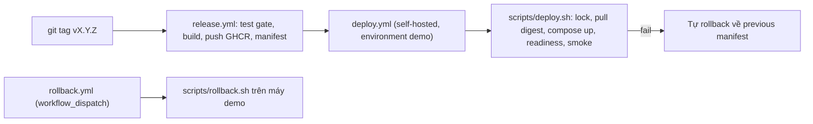

# DevOps — Kế hoạch CI/CD, deployment và observability

- Trạng thái: **Đề xuất** — chờ team review.
- Người phụ trách: **Nguyễn Mai Hoàng Anh** (DevOps)
- Task liên quan: [TASK-004](../tasks/TASK-004-container-ci.md), [TASK-005](../tasks/TASK-005-release-deploy.md), [TASK-006](../tasks/TASK-006-observability.md), [TASK-007](../tasks/TASK-007-reliability-demo.md)
- Ngày: 19/10/2026

Tài liệu này mô tả cách hoàn thiện CI/CD, deployment, observability, incident drill và rollback trên nền đã có trong repository. Thiết kế tổng thể vẫn theo [Runtime view](../architecture/runtime-view.md) và [ADR-001](../architecture/adr/001-use-docker-compose.md).

## 1. Quyết định chính

| Chủ đề | Quyết định | Lý do |
| --- | --- | --- |
| Runtime | Docker Compose trên một máy Linux (ADR-001) | Đủ cho MVP; deploy/rollback scripts của TASK-005 đã dựa trên Compose |
| Hạ tầng | Không dùng cloud. Ưu tiên VM local (Multipass, 2 vCPU / 4–6 GB RAM / 30 GB disk); máy yếu thì chạy trực tiếp trên host Linux | Không tốn chi phí, tái tạo được |
| Kết nối CI → máy demo | GitHub **self-hosted runner** cài trên máy demo, label `demo` | Runner kết nối ra ngoài, không cần IP public hay mở port |
| Truy cập khi demo | Cùng LAN, hoặc Tailscale / Cloudflare Tunnel | Team và giảng viên xem được UI, Grafana |
| Kubernetes (k3s) | Chỉ là hướng mở rộng sau khi MVP hoàn thành; cần ADR-002 nếu làm | Tránh làm lại TASK-005 và rủi ro cho evidence |

## 2. Hiện trạng

Cập nhật ngày 28/10/2026.

**Đã có**

- `ci.yml`: ruff, backend unit/integration với PostgreSQL 16, frontend lint/test/build, E2E
  Playwright qua Compose, Compose smoke + E13, validate cấu hình observability, build image + Trivy.
- `release.yml`: khi push tag `v*`, chạy test gate, push image backend và frontend lên GHCR, sinh
  release manifest có cả hai digest, tạo GitHub Release.
- `deploy.yml` và `rollback.yml` chạy trên self-hosted runner `demo`, state ở `/opt/booking/state`,
  dùng chung concurrency `deploy-demo`; deploy cần duyệt qua environment `demo`. Xem
  [demo-host.md](demo-host.md).
- `deploy/compose.production.yaml` chỉ mở cổng web (Nginx); migration chạy từ image release.
- Đường deploy → deploy → rollback đã diễn tập cục bộ:
  [kết quả 27/10](../evidence/2026-10-27-cd-local-rehearsal.md).

- Máy demo `booking-demo` và runner `demo` đã hoạt động; `v0.2.1` deploy qua pipeline, E08 đạt:
  [kết quả 28/10](../evidence/2026-10-28-e08-demo-deploy.md).

**Còn thiếu**

1. Chưa chạy `rollback.yml` trên máy demo (cần release thứ hai; E12 cùng TASK-005/TASK-007).
2. Observability stack chưa được deploy cùng ứng dụng trên máy demo (lịch tuần 4).

## 3. Giai đoạn A — Hoàn thiện CI (TASK-004)

| Việc | Chi tiết | Evidence |
| --- | --- | --- |
| Tối ưu workflow | `concurrency: ci-${{ github.ref }}` hủy run cũ; cache pip/npm | — |
| Compose smoke test | `docker compose up -d --wait` → `scripts/smoke_test.py` → recreate backend → đọc lại booking cũ | E13 |
| Image scan | Trivy scan image backend/frontend, báo cáo (không chặn) ở giai đoạn đầu | — |
| Frontend | Job lint/test/build; Dockerfile multi-stage (Node build → Nginx). Nginx serve UI và proxy `/api` → backend; chỉ mở một web port | E06 (phối hợp TASK-003) |
| Gate chặn merge | Branch protection trên `main`: bắt buộc các check pass; tạo PR cố ý fail test làm bằng chứng | E07 |
| Tài liệu | Hướng dẫn chạy local và bảng biến môi trường: [local-dev.md](local-dev.md) | — |

## 4. Giai đoạn B — Continuous Deployment lên máy demo



- Tạo `deploy.yml` chạy trên `runs-on: [self-hosted, demo]`, kích hoạt sau release hoặc bằng `workflow_dispatch` (input: tag). Dùng GitHub Environment `demo` có bước duyệt.
- Sửa `rollback.yml` chạy trên self-hosted runner.
- Lưu `current-manifest.json`, `previous-manifest.json` và `.env.production` ở thư mục cố định trên máy demo (ví dụ `/opt/booking/state`), không lưu trong workspace của runner.
- `concurrency: deploy-demo` cho cả deploy và rollback; lock trong script vẫn giữ làm lớp bảo vệ thứ hai.
- Bổ sung digest của frontend vào release manifest.
- **Bảo mật:** không chạy job `pull_request` trên self-hosted runner. CI thường vẫn dùng `ubuntu-latest`; runner chỉ nhận job deploy/rollback.

Các thay đổi trong `scripts/deploy.py` và `scripts/rollback.py` (thuộc TASK-005) được trao đổi với người phụ trách TASK-005 trước khi merge.

## 5. Giai đoạn C — Observability và alert (TASK-006)

### 5.1 Instrument backend (`backend/app/telemetry/`)

- OpenTelemetry SDK cùng instrumentation cho FastAPI, SQLAlchemy/asyncpg và logging; export OTLP tới Collector.
- Resource attributes: `service.name=booking-api`, `service.version=$BOOKING_RELEASE`, `deployment.environment`. Dùng để nối telemetry với release.
- Metric nghiệp vụ `booking_conflicts_total` (tăng khi trả 409).
- Log JSON ra stdout với `trace_id`, `span_id`, method, route template, status, duration, version. Không ghi request body, mật khẩu hoặc tên khách hàng.
- Metric labels dùng route template (`/api/appointments/{id}`), không chứa UUID hay trace ID.
- `BatchSpanProcessor` với timeout và queue giới hạn; test `test_booking_when_collector_unavailable` (E10).

### 5.2 Stack monitoring

```text
deploy/
  compose.observability.yaml
  observability/
    otel-collector/config.yaml     # OTLP in → traces: Tempo, logs: Loki, metrics: Prometheus exporter
    prometheus/prometheus.yml      # scrape collector, blackbox, node-exporter, cAdvisor
    prometheus/rules/*.yml         # alert rules
    blackbox/blackbox.yml          # probe /health/ready qua web
    alertmanager/alertmanager.yml  # gửi Discord/Telegram webhook
    tempo/ loki/                   # config, volume, retention ngắn
    grafana/provisioning/          # datasources + dashboards dạng code
```

- Grafana provisioning bật liên kết Tempo → Loki (theo `trace_id`), Loki → Tempo (derived field) và exemplars từ Prometheus. Mục tiêu: từ dashboard tới trace tới log của cùng một request lỗi.
- Dashboard: request rate, tỷ lệ 5xx, latency p50/p95/p99 theo route, booking conflicts, trạng thái probe, annotation thời điểm deploy và version.
- CI validate cấu hình: `promtool check rules`, `amtool check-config`, `otelcol validate`.
- Tài nguyên dự kiến của toàn bộ stack khoảng 2–3 GB RAM; đo thực tế trước drill.

### 5.3 Alert rules

| Alert | Điều kiện | Evidence |
| --- | --- | --- |
| `HighErrorRate` | Tỷ lệ 5xx > 5% trong cửa sổ 1 phút, ≥100 request, duy trì 2 phút | E11 |
| `ApiProbeDown` | `probe_success == 0` trong 1 phút | E16 |
| `HighLatencyP95` (tùy chọn) | p95 > 500 ms trong 5 phút | E15 |

## 6. Giai đoạn D — Incident drill và rollback (TASK-007)

- **Fault injection** bằng biến môi trường có thời hạn: `BOOKING_FAULT_MODE=error|latency`, `BOOKING_FAULT_RATE`, `BOOKING_FAULT_UNTIL`. Fault được ghi trong manifest của release drill (ví dụ `v0.2.0-drill`). Cần thống nhất với người phụ trách backend.
- **Load test** bằng k6 (`loadtest/booking.js`): 10 request/giây trong 10 phút; ghi cấu hình máy, dữ liệu và version (E15).
- **Kịch bản demo:**
  1. Deploy `v0.2.0-drill` qua pipeline.
  2. Chạy k6; 5xx/latency tăng.
  3. Alert firing, thông báo tới kênh chat.
  4. Grafana: dashboard → trace lỗi → log, xác định `service.version` gây lỗi.
  5. Chạy `rollback.yml`; smoke test pass.
  6. Alert resolved; xác nhận booking cũ còn nguyên.
- Ghi timestamp từng mốc vào `docs/incidents/<date>-booking-drill.md` theo mẫu trong [Evidence](../evidence.md).
- Mở rộng tùy chọn: Alertmanager webhook gọi `repository_dispatch` để tự rollback. Mặc định vẫn rollback thủ công cho dễ giải thích.

## 7. Thứ tự thực hiện và phụ thuộc

| Thứ tự | Giai đoạn | Phụ thuộc | Ghi chú |
| --- | --- | --- | --- |
| 1 | A — CI | TASK-003 cho phần frontend | Phần backend làm ngay được |
| 2 | B — CD | Máy demo + self-hosted runner | Phối hợp TASK-005 |
| 3 | C — Observability | A; chạy thử local trước | Làm song song với B được; phối hợp TASK-006 |
| 4 | D — Drill | B và C | Kết quả cập nhật E09–E16 |

## 8. Ngoài phạm vi hiện tại

- Kubernetes/k3s, Helm, GitOps: xem xét sau MVP, cần ADR-002.
- High availability, zero-downtime deployment: không cam kết với mô hình một máy.
- Probe từ bên ngoài máy demo: probe cùng máy không phát hiện được khi cả máy ngừng hoạt động; ghi rõ giới hạn này trong báo cáo.
