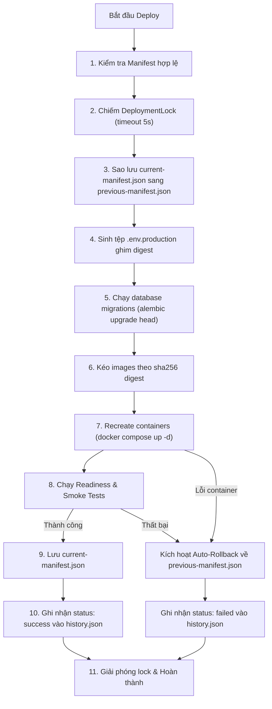

# Quy trình Release, Deployment và Rollback (Release Process)

Tài liệu này quy định chi tiết quy trình phát hành (release), triển khai (deployment), giám sát thời gian thực thi (history audit), và khôi phục sự cố (rollback) cho hệ thống Booking Service theo yêu cầu của **TASK-005** và **TASK-007**.

---

## 1. Release Manifest Specification

Mọi phiên bản phát hành bắt buộc phải được đóng gói kèm một **Release Manifest** định dạng JSON (định nghĩa tại [scripts/release_manifest.py](../../scripts/release_manifest.py)).

### 1.1 Cấu trúc Manifest
Manifest chứa đầy đủ thông tin truy vết của một release:
- `release`: Phiên bản SemVer (ví dụ: `v0.1.0`, `v0.2.0`).
- `commit_sha`: Git commit SHA 40 ký tự hex viết thường.
- `migration_revision`: Mã migration của Alembic tương ứng với schema database của release này.
- `images`: Bản đồ định danh Docker images:
  - `backend`: Image dịch vụ API backend (**bắt buộc**).
  - `frontend`: Image giao diện người dùng web (**tùy chọn**, hỗ trợ từ `v0.2.0`).

### 1.2 Quy tắc Image Digest (Bất biến)
- **Bắt buộc dùng digest**: Mọi image trong manifest bắt buộc phải có `digest` định dạng `sha256:<64-hex>`.
- **Cấm tuyệt đối tag `:latest`**: Hệ thống kiểm tra hợp lệ (`manifest.validate()`) sẽ báo lỗi nếu image sử dụng tag `latest`.
- **Pinned Reference**: Khi kéo image hoặc ghi cấu hình, tham chiếu đầy đủ có dạng `<repository>@sha256:<digest>`, ngăn ngừa hoàn toàn tình trạng trôi phiên bản (image drift).

### 1.3 Tạo và Kiểm tra Manifest qua CLI
```bash
# Tạo release manifest có cả backend và frontend
python -m scripts.release_manifest create \
  --release v0.2.0 \
  --commit-sha a1b2c3d4e5f6789012345678901234567890abcd \
  --migration-revision 20261007_0001 \
  --backend-digest sha256:1111111111111111111111111111111111111111111111111111111111111111 \
  --frontend-digest sha256:2222222222222222222222222222222222222222222222222222222222222222 \
  --output deploy/manifest.json

# Kiểm tra tính hợp lệ của manifest
python -m scripts.release_manifest validate --manifest deploy/manifest.json
```

---

## 2. Quản lý Thư mục Trạng thái (`BOOKING_STATE_DIR`)

Để đảm bảo quy trình deploy và rollback hoạt động ổn định trên máy chủ chạy self-hosted runner (tránh lưu trạng thái trong workspace tạm của GitHub Actions), hệ thống hỗ trợ cấu hình thư mục trạng thái qua biến môi trường hoặc tham số CLI.

### 2.1 Cấu hình
- **Biến môi trường**: `BOOKING_STATE_DIR` (ví dụ trên máy demo Linux: `/opt/booking/state`).
- **Tham số dòng lệnh**: `--state-dir <path>` trong `deploy.py` và `rollback.py`.
- **Giá trị mặc định**: Thư mục `deploy/` trong repository.

### 2.2 Các tệp quản lý trong State Directory
1. `current-manifest.json`: Manifest của release đang chạy thực tế trên host.
2. `previous-manifest.json`: Manifest của release ổn định trước đó (dùng để rollback tức thì).
3. `.env.production`: Tệp biến môi trường được sinh tự động, chứa digest image đã ghim (`BACKEND_IMAGE_REF`, `FRONTEND_IMAGE_REF`), `BOOKING_RELEASE`, và `BOOKING_COMMIT_SHA`.
4. `.deploy.lock/`: Khóa mutex nguyên tử (`DeploymentLock`), ngăn chặn chạy deploy hoặc rollback đồng thời.
5. `history.json`: Tệp lưu vết lịch sử mọi lần deploy và rollback (xem chi tiết ở mục 4).

---

## 3. Luồng Triển khai (Deployment Workflow)

Quy trình deploy được thực hiện thông qua script [scripts/deploy.py](../../scripts/deploy.py) hoặc wrapper [scripts/deploy.sh](../../scripts/deploy.sh):



### Tiêu chí kiểm tra Smoke Test:
- `/health/ready`: Trả về `200 OK` (database kết nối tốt).
- `/api/version`: Khớp chính xác `release` và `commit_sha` trong manifest.
- Nghiệp vụ: Xem slot trống (`GET /api/slots`), tạo booking (`POST /api/appointments`), và huỷ booking (`DELETE /api/appointments/{id}`).

---

## 4. Lịch sử Triển khai và Đo lường SLO (`history.json`)

Mọi thao tác deploy và rollback đều được module [scripts/deploy_history.py](../../scripts/deploy_history.py) ghi lại vào `history.json` trong `BOOKING_STATE_DIR`.

### 4.1 Cấu trúc bản ghi Lịch sử
```json
[
  {
    "operation": "deploy",
    "release": "v0.1.0",
    "commit_sha": "e0426ba69da49d4f2bd56718a0f7a6392d8dcae2",
    "status": "success",
    "started_at": "2026-10-23T08:00:00.000000+00:00",
    "ended_at": "2026-10-23T08:00:04.250000+00:00",
    "duration_seconds": 4.25
  },
  {
    "operation": "rollback",
    "release": "v0.1.0",
    "commit_sha": "e0426ba69da49d4f2bd56718a0f7a6392d8dcae2",
    "status": "success",
    "started_at": "2026-10-23T08:05:00.000000+00:00",
    "ended_at": "2026-10-23T08:05:01.120000+00:00",
    "duration_seconds": 1.12,
    "slo_met": true
  }
]
```

### 4.2 Mục tiêu Phục hồi (SLO Rollback ≤ 5 phút)
- Trường `slo_met` được tự động tính toán cho các thao tác rollback:
  - `duration_seconds <= 300.0`: Đạt chuẩn SLO (`slo_met: true`).
  - `duration_seconds > 300.0`: Vi phạm SLO (`slo_met: false`), in cảnh báo ra log.
- `history.json` đóng vai trò là bằng chứng số liệu phục vụ đánh giá tiêu chí **E11** và **E12**.

---

## 5. Quy trình Rollback (Khôi phục Phiên bản Cũ)

Khi cần rollback thủ công hoặc khi auto-rollback được kích hoạt do deploy thất bại:

1. **Khóa Mutex**: Đảm bảo không có tiến trình deploy nào khác can thiệp.
2. **Khôi phục cấu hình**: Nạp `previous-manifest.json`, ghi lại `.env.production` trỏ về image digest cũ.
3. **Tái khởi động container**: Dùng `docker compose up -d --remove-orphans`.
4. **Bảo toàn dữ liệu**: **Tuyệt đối không xóa PostgreSQL volume**. Toàn bộ lịch đặt trước đó vẫn còn nguyên.
5. **Kiểm tra nghiệp vụ**: Xác nhận readiness và smoke tests trên phiên bản cũ.
6. **Cập nhật trạng thái**: Đặt lại `current-manifest.json` và ghi vết vào `history.json`.

```bash
# Lệnh rollback thủ công
python -m scripts.rollback --target-manifest deploy/previous-manifest.json

# Hoặc dùng script shell:
./scripts/rollback.sh
```

---

## 6. Chính sách Tương thích Schema (Expand / Contract)

Mọi thay đổi cấu trúc cơ sở dữ liệu phải tuân thủ nghiêm ngặt theo [migration-policy.md](migration-policy.md):
- Không xóa hoặc đổi tên cột trong một release đơn lẻ.
- Mọi cột mới thêm trong cửa sổ rollback bắt buộc phải `nullable=True` hoặc có `server_default`.
- Đảm bảo phiên bản phần mềm cũ vẫn có thể đọc/ghi dữ liệu bình thường sau khi rollback mà không gặp lỗi DB integrity.
