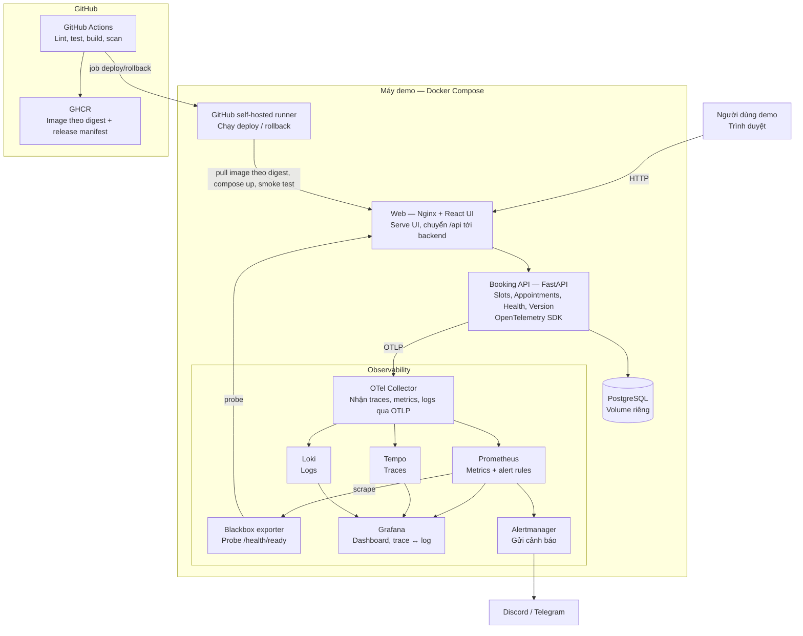
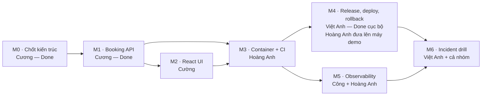

# Phân công công việc — Dịch vụ đặt lịch (Production Readiness Lab)

Ngày: 21/10/2026

## 1. Tổng quan

Đề bài: *"Xây dựng một dịch vụ đặt lịch nhỏ rồi bổ sung CI/CD, container, logs, metrics, traces, alert và rollback có thể trình diễn."*

Nghiệp vụ được giữ ở mức nhỏ nhất đủ để tạo tải thật. **Trọng tâm của dự án là vận hành:** phát hiện lỗi, điều tra lỗi và khôi phục hệ thống, tất cả đều trình diễn được.

**Phạm vi nghiệp vụ (đã có backend):**

- Xem slot trống theo ngày (`GET /api/slots`).
- Đặt lịch (`POST /api/appointments`); đặt trùng slot thì nhận `409`.
- Xem danh sách lịch (`GET /api/appointments`).
- Huỷ lịch (`DELETE /api/appointments/{id}`).
- Health và version (`/health/live`, `/health/ready`, `/api/version`).

**Không làm:** tài khoản người dùng, thanh toán, kết nối ngân hàng, email, nhiều cơ sở.

**MVP bắt buộc:** API + UI, tests, Docker, CI, deployment, observability (logs, metrics, traces, alert), incident drill, rollback.

## 2. Sơ đồ kiến trúc

Toàn bộ hệ thống chạy bằng Docker Compose trên một máy Linux, không dùng cloud (theo [ADR-001](docs/architecture/adr/001-use-docker-compose.md)). Hơn một nửa số thành phần thuộc phần quan sát hệ thống.

Đọc sơ đồ:

- **Ứng dụng:** request đi từ UI qua Nginx tới API rồi xuống PostgreSQL.
- **Telemetry:** API gửi telemetry qua Collector tới ba kho Prometheus, Tempo và Loki. Grafana đọc cả ba kho, nhờ đó từ một request lỗi có thể đi tới trace rồi tới log của chính request đó.
- **Probe độc lập:** blackbox exporter kiểm tra API từ bên ngoài, nên vẫn phát hiện được API chết ngay cả khi API không còn gửi metric nào.

## 3. Phân công

### 3.1 Tổng quan theo người

| Người | Role | Task | Trạng thái | Trọng tâm hiện tại |
| --- | --- | --- | --- | --- |
| Phạm Minh Cương (23001840) | Backend + kiến trúc | TASK-001, TASK-002 | Done | API, fault injection, JSON log, OTel và review kiến trúc/migration đã bàn giao |
| Lê Văn Cường | Frontend + E2E | TASK-003 | Done | React UI, test E2E |
| Nguyễn Mai Hoàng Anh | DevOps — CI/CD và hạ tầng monitoring | TASK-004 (+ hạ tầng TASK-006) | In Progress | CI, CD lên máy demo, dựng stack observability |
| Nguyễn Việt Anh | Release và độ tin cậy | TASK-005, TASK-007 | TASK-005 Done | Load test, incident drill, rollback, evidence |
| Vũ Thành Công | Observability — telemetry, dashboard, alert | TASK-006 | In Progress | Instrument OpenTelemetry, dashboard, alert rules |

TASK-001 đã giao và chốt bởi Phạm Minh Cương theo yêu cầu hoàn tất phần backend/kiến trúc.
TASK-007 vẫn là đề xuất giao cho Việt Anh trong kế hoạch này; nhóm cần xác nhận owner trong
`docs/tasks/` trước khi bắt đầu drill chung. Trong TASK-006, Hoàng Anh dựng hạ tầng (các
container, cấu hình lưu trữ), còn Công làm phần nội dung (instrument, dashboard, alert).

### 3.2 Ai làm phần nào của MVP

**In đậm** là người chịu trách nhiệm chính và chốt khi phần đó xong. Những người còn lại hỗ trợ.

| Hạng mục MVP | Người làm | Evidence |
| --- | --- | --- |
| API đặt lịch | **Cương** | E01–E05 (đã đạt cục bộ) |
| UI đặt và huỷ lịch | **Cường** | E06 |
| Unit test và integration test backend | **Cương** | E01–E05 |
| Component test và E2E UI → API → DB | **Cường** | E06 |
| Dockerfile backend, frontend; Compose local | **Hoàng Anh**, Cường (Dockerfile frontend) | E13 |
| CI chặn code lỗi | **Hoàng Anh** | E07 |
| Release manifest, image theo digest | **Việt Anh** | E08 (đã đạt cục bộ) |
| Deploy lên máy demo qua pipeline | **Hoàng Anh**, Việt Anh | E08, E12 |
| Logs JSON có `trace_id` | **Công**, Cương | E09 |
| Metrics HTTP và metric nghiệp vụ | **Công**, Cương | E09 |
| Traces HTTP và DB | **Công** | E09 |
| Telemetry lỗi không làm hỏng việc đặt lịch | **Công**, Cương | E10 |
| Stack Collector, Prometheus, Tempo, Loki, Grafana | **Hoàng Anh** | E09 |
| Dashboard và liên kết trace ↔ log | **Công** | E09 |
| Alert tỷ lệ 5xx và alert probe | **Công**, Hoàng Anh (Alertmanager, blackbox) | E11, E16 |
| Fault injection có thời hạn | **Cương** | E11 |
| Load test 10 request/giây | **Việt Anh** | E15 |
| Incident drill và rollback ≤ 5 phút | **Việt Anh** | E11, E12 |
| Incident report và cập nhật evidence | **Việt Anh**, cả nhóm | E01–E16 |

### 3.3 Chi tiết từng người

#### Phạm Minh Cương — Backend và kiến trúc

**Mục tiêu:** API ổn định, sinh telemetry có ý nghĩa, và có công tắc để tạo lỗi khi demo.

- **Chốt kiến trúc (TASK-001):** tổ chức buổi review tài liệu kiến trúc và ADR-001 với cả nhóm; cập nhật trạng thái ADR thành Accepted.
- **Fault injection:** thêm cấu hình gây lỗi có thời hạn qua biến môi trường.
    - `BOOKING_FAULT_MODE=error|latency`: trả 500, hoặc chậm 3 giây, trước khi ghi DB.
    - `BOOKING_FAULT_RATE`: tỷ lệ request bị ảnh hưởng.
    - `BOOKING_FAULT_UNTIL`: thời điểm fault tự tắt.
    - Viết unit test cho cả ba biến.
- **Hỗ trợ instrument:** cùng Công gắn span cho tầng service (`booking.create`, `booking.cancel`), tăng metric `booking_conflicts_total` khi trả 409, đưa `release` và `commit_sha` vào resource attributes.
- **Log có cấu trúc:** chuyển log sang JSON ra stdout gồm method, route template, status, duration, `trace_id`. Không ghi request body hoặc tên khách.
- **Tương thích rollback:** review mọi migration theo [migration-policy.md](docs/releases/migration-policy.md).

**Bàn giao ngày 25/10/2026:** TASK-001 và TASK-002 Done; fault injection kèm test, log JSON,
span/metric/resource attributes đã merge qua PR #14. ADR-001 Accepted, module/runtime views và
review migration được cập nhật trong [Architecture review](docs/evidence/2026-10-25-architecture-review.md).
Khi có migration mới, Cương tiếp tục review tương thích trước khi deploy; đây là trách nhiệm
duy trì, không phải hạng mục code còn thiếu của lần bàn giao này.

#### Lê Văn Cường — Frontend và E2E

**Mục tiêu:** UI đủ để người dùng đặt và huỷ lịch, đồng thời là công cụ tạo request thật khi demo.

- **React UI (TASK-003):**
    - Chọn ngày, xem slot trống, form đặt lịch, danh sách lịch, nút huỷ.
    - Hiển thị theo múi giờ `Asia/Ho_Chi_Minh`.
    - Đủ các trạng thái loading, rỗng, lỗi; lỗi `409` hiện "Slot đã có người đặt", không báo thành công.
    - Footer hiển thị version lấy từ `/api/version`, để khi demo thấy ngay đang chạy release nào.
- **Đóng gói:** Dockerfile frontend (build bằng Node, serve bằng Nginx) và cấu hình Nginx proxy `/api` tới backend. Phối hợp với Hoàng Anh.
- **Test:** component test bằng Vitest; E2E bằng Playwright cho luồng xem slot → đặt → thấy trong danh sách → huỷ; E2E chạy trong CI.

**Bàn giao:** mã nguồn frontend, Dockerfile, cấu hình Nginx, component test, E2E (E06).

#### Nguyễn Mai Hoàng Anh — DevOps: CI/CD và hạ tầng monitoring

**Mục tiêu:** mọi thay đổi đi qua pipeline tự động, deploy lên máy demo bằng một thao tác, và stack observability chạy ổn định.

- **CI (TASK-004):**
    - Bổ sung `concurrency`, cache, job frontend, Trivy scan.
    - Job Compose smoke test: dựng stack → smoke test → recreate backend → booking cũ vẫn còn (E13).
    - Bật branch protection; tạo PR cố ý fail để lấy bằng chứng (E07).
- **Máy demo:** dựng VM Multipass (hoặc chạy trực tiếp trên máy), cài Docker và GitHub self-hosted runner gắn label `demo`.
- **CD:**
    - Viết `deploy.yml` chạy trên self-hosted runner, có GitHub Environment duyệt thủ công.
    - Sửa `rollback.yml` cho chạy trên máy demo; lưu manifest ở thư mục cố định.
    - Thêm `concurrency` để deploy và rollback không bao giờ chạy cùng lúc.
    - Phối hợp với Việt Anh vì scripts thuộc TASK-005.
- **Hạ tầng observability:**
    - `deploy/compose.observability.yaml` gồm OTel Collector, Prometheus, Tempo, Loki, Grafana, Alertmanager, blackbox exporter, node-exporter, cAdvisor.
    - Cấu hình pipeline của Collector, volume và retention, provisioning datasource cho Grafana (bật liên kết trace ↔ log).
    - Alertmanager gửi về Discord hoặc Telegram.
    - CI validate cấu hình bằng `promtool`, `amtool`, `otelcol validate`.
- **Tài liệu:** hướng dẫn chạy local, bảng biến môi trường, runbook deploy và rollback.

**Bàn giao:** workflows CI/CD, compose files, cấu hình stack observability, runbook (E07, E13).

#### Nguyễn Việt Anh — Release và độ tin cậy

**Mục tiêu:** chứng minh bằng số liệu rằng hệ thống phát hiện được sự cố và khôi phục được trong 5 phút.

- **Release (TASK-005, đã xong):** bảo trì release manifest và scripts deploy/rollback; thêm digest frontend vào manifest; hỗ trợ Hoàng Anh đưa deploy lên máy demo.
- **Load test:** viết script k6 tạo tải 10 request/giây trong 10 phút, trộn xem slot, đặt và huỷ; lưu kết quả kèm cấu hình máy (E15).
- **Release drill:** chuẩn bị release `v0.2.0-drill` bật fault injection, ghi cấu hình fault vào manifest.
- **Incident drill (TASK-007):**
    - Chạy kịch bản ở mục 6; ghi timestamp từng mốc.
    - Đo thời gian từ lúc gây lỗi tới lúc alert, và thời gian rollback.
    - Kiểm tra booking cũ còn nguyên sau rollback.
- **Evidence:** viết incident report trong `docs/incidents/`; cập nhật trạng thái E01–E16 trong [docs/evidence.md](docs/evidence.md).

**Bàn giao:** script k6, release drill, incident report, bảng evidence đã cập nhật (E11, E12, E15).

#### Vũ Thành Công — Observability: telemetry, dashboard, alert

**Mục tiêu:** từ một request lỗi đi được tới metric, trace và log liên quan, và cảnh báo đến đúng lúc.

- **Instrument backend (`backend/app/telemetry/`):**
    - OpenTelemetry SDK; instrumentation cho FastAPI, SQLAlchemy và logging; export OTLP tới Collector.
    - Resource attributes: `service.name`, `service.version`, `deployment.environment`.
    - Batch export có timeout và hàng đợi giới hạn; viết test chứng minh Collector chết thì đặt lịch vẫn thành công (E10).
    - Metric labels chỉ dùng route template, không chứa UUID hoặc trace ID.
- **Dashboard Grafana (lưu dạng JSON trong repo):**
    - Request rate, tỷ lệ 5xx, latency p50/p95/p99 theo route.
    - Số booking conflict, trạng thái probe.
    - CPU, RAM, disk của máy và của từng container.
    - Đánh dấu thời điểm deploy và version đang chạy.
- **Alert rules:**
    - `HighErrorRate`: 5xx > 5% trong 1 phút, ≥ 100 request, kéo dài 2 phút.
    - `ApiProbeDown`: probe fail kéo dài 1 phút.
    - `HighLatencyP95`: p95 > 500 ms (tuỳ chọn).
- **Kiểm chứng:** query mẫu và ảnh chụp đi từ dashboard → trace → log của một request lỗi, lưu vào `docs/evidence/observability/` (E09, E11, E16).

**Bàn giao:** module telemetry kèm test, dashboard JSON, alert rules, evidence observability.

### 3.4 Phụ thuộc giữa các thành viên

| Ai cần | Cần gì | Từ ai |
| --- | --- | --- |
| Hoàng Anh | UI và Dockerfile frontend để hoàn thiện CI, Compose | Cường |
| Công | Stack Collector, Prometheus, Tempo, Loki, Grafana chạy được ở local | Hoàng Anh |
| Công | Điểm gắn span, metric trong code backend | Cương |
| Việt Anh | Fault injection | Cương |
| Việt Anh | Dashboard và alert hoạt động | Công |
| Việt Anh | Deploy và rollback chạy trên máy demo | Hoàng Anh |
| Cường | E2E chạy trong CI | Hoàng Anh |

## 4. Công nghệ theo role

| Role | Công nghệ chính | Công cụ hỗ trợ |
| --- | --- | --- |
| Backend (Cương) | Python 3.12, FastAPI, SQLAlchemy async, Alembic, PostgreSQL 16, Pydantic Settings | pytest, ruff |
| Frontend (Cường) | React + Vite + TypeScript, TanStack Query, Nginx | Vitest + React Testing Library, Playwright, ESLint |
| DevOps CI/CD + hạ tầng (Hoàng Anh) | Docker, Docker Compose, GitHub Actions, GHCR, self-hosted runner, Multipass | Trivy, promtool, amtool, Tailscale (truy cập từ xa khi demo) |
| Release và độ tin cậy (Việt Anh) | Release manifest, scripts deploy/rollback (Python), k6 | GitHub Releases, `jq` |
| Observability (Công) | OpenTelemetry Python SDK, OTel Collector, Prometheus, Tempo, Loki, Grafana, Alertmanager, blackbox exporter | node-exporter, cAdvisor, Discord webhook |

## 5. Lộ trình

Các mốc M0–M6 lấy theo [Evidence](docs/evidence.md). Cột lộ trình bên phải (M3 → M5 → M6) là trọng tâm của dự án. M4 đã xong ở mức cục bộ.

M2 không chặn phần backend của M3 và M5. Hoàng Anh và Công có thể bắt đầu ngay với backend đã có, sau đó bổ sung frontend khi Cường xong.

## 6. Kịch bản demo và người thực hiện

| Bước | Việc | Người thực hiện | Hiện trên màn hình |
| --- | --- | --- | --- |
| 1 | Giới thiệu kiến trúc, đặt và huỷ một lịch trên UI | Cương, Cường | UI, version ở footer |
| 2 | Mở PR có test lỗi → CI fail, không merge được | Hoàng Anh | GitHub Actions |
| 3 | Push tag → build, push image, deploy lên máy demo | Hoàng Anh | Workflow, `/api/version` |
| 4 | Chạy k6 10 request/giây; xem dashboard bình thường | Việt Anh, Công | Grafana |
| 5 | Deploy `v0.2.0-drill` có fault → 5xx tăng | Việt Anh | Grafana |
| 6 | Alert bắn về Discord | Công | Discord, Alertmanager |
| 7 | Điều tra: dashboard → trace lỗi → log; xác định release gây lỗi | Công | Grafana, Tempo, Loki |
| 8 | Chạy workflow rollback; smoke test pass | Việt Anh, Hoàng Anh | GitHub Actions |
| 9 | Alert resolved, booking cũ còn nguyên; đọc incident report | Việt Anh | Grafana, UI, report |
| 10 | Dừng API → probe alert dù không còn metric HTTP | Công | Alertmanager |

## 7. Quy ước làm việc nhóm

- Mọi thay đổi vào `main` đi qua pull request, CI xanh và có ít nhất một người review. Không tự merge PR của mình.
- Nhánh: `feat/task-00x-<mô-tả>`, `fix/...`, `docs/...`. PR ghi ID task, ví dụ `TASK-006`.
- Commit theo Conventional Commits, ví dụ `feat(telemetry): add booking conflict counter`.
- Cập nhật trạng thái trong [docs/tasks/README.md](docs/tasks/README.md) khi bắt đầu và khi xong task.
- Chỉ chuyển task sang Done khi đã có evidence tương ứng trong [docs/evidence.md](docs/evidence.md).
- Không commit secrets; dùng `.env.example` và GitHub Secrets.
